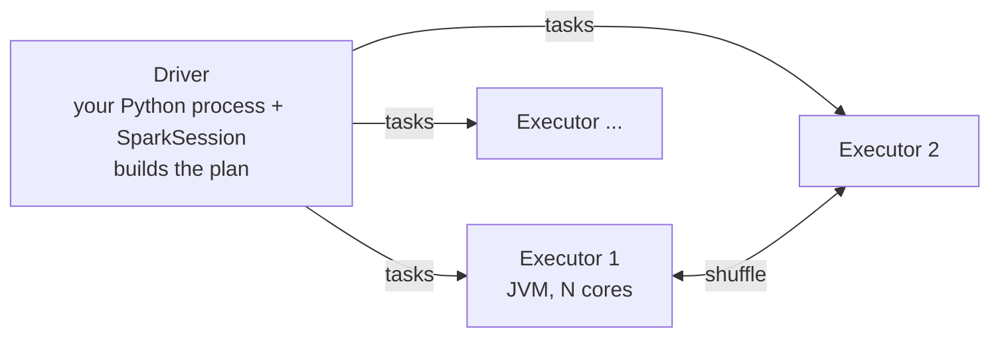

# M1 · Mental model

> **Module question:** What actually happens when I call `.count()`?
> **Cross-cutting threads:** Failure modes · Tradeoff ledger
> **Domain spine:** ShopCo clickstream (2B events/month, Parquet on S3)

---

## Opening scene: the notebook that "hangs"

You write ten lines of filters and joins on the clickstream. Every cell runs in under a second, and you feel productive. Then you call `df.count()` to sanity-check, and it runs for 14 minutes.

Nothing was slow before. Nothing had *run* before.

> **Failure mode (the module in one line):** treating Spark like pandas (eager and single-machine) instead of a lazy, distributed query planner.

---

## 0. Spark and PySpark in one screen

**What is Spark?**
- An open-source engine for processing large datasets across many machines
- Written in Scala, runs on the JVM (Java Virtual Machine: the runtime that executes Java and Scala programs)
- One engine for SQL, batch ETL (extract, transform, load: read raw data, reshape it, write it back), streaming (Structured Streaming) and ML (MLlib, Spark's ML library)
- Keeps intermediate data in memory where it can; Hadoop MapReduce (the older big-data engine) wrote it to disk after every step
  - Within a stage, steps are chained in memory (see [Jobs → stages → tasks](#3-jobs--stages--tasks-and-the-shuffle))
  - At a shuffle, Spark still writes to local disk: the win is fewer disk round-trips, not zero disk
- Does not store data itself: it reads from and writes to S3, HDFS, ADLS/GCS (cloud or cluster file storage), or Delta/Iceberg tables (Parquet files plus a transaction log)
- Runs on YARN, Kubernetes, standalone clusters, or managed platforms (Databricks, EMR, Dataproc)
  - These are cluster managers or platforms (see [Driver, executors, cluster](#1-driver-executors-cluster)): recognize the names, you don't need them yet

**What is PySpark?**
- The Python API for Spark: `pip install pyspark`
- Gives you `SparkSession`, DataFrames, `pyspark.sql.functions`, `pyspark.ml` and `pyspark.pandas`
  - `SparkSession`: your entry point; every read starts from it (`spark.read...`)
  - DataFrame: a table with named columns, like a pandas DataFrame, but split into chunks across machines
  - `pyspark.sql.functions`: built-in column functions, usually imported as `F`
  - `pyspark.ml`: the DataFrame API of MLlib (M4)
  - `pyspark.pandas`: pandas-style syntax that runs on Spark (M4)

**How do Spark and PySpark relate?**
- Your Python code only *builds a query plan* (a recipe of steps; see [Lazy evaluation](#2-lazy-evaluation-transformations-vs-actions)); the JVM engine executes it
- Python and the JVM communicate through Py4J (a library that lets Python call Java objects) on the driver (the process that runs your script; see [Driver, executors, cluster](#1-driver-executors-cluster))
- Built-in DataFrame operations run at the same speed from Python, Scala or SQL, because all three compile to the same Catalyst plan (Catalyst: Spark's query optimizer)
- Python code runs on executors (worker processes) only for UDFs (your own Python functions applied to columns), pandas UDFs, `applyInPandas`/`mapInPandas` and RDD lambdas (RDD: Spark's older low-level API, not used in this course), which is why those are slower (M2)
- Spark Connect (3.4+) adds a thin-client mode in which your Python process talks to a remote Spark server

**Why use PySpark?**
- It handles data bigger than one machine's RAM: pandas holds everything on one machine, while Spark spreads partitions (chunks of rows; see [Partitions](#4-partitions)) across many machines and processes them in parallel
- The same code runs on a 1 GB sample on your laptop and on 1 TB on a cluster; you change the cluster size, not the logic
  - At full scale you may still tune configs (shuffle partitions, memory) or fix skew (M3)
- You stay in Python (no Scala or Java), and results flow straight into sklearn, XGBoost and notebooks
- pandas concepts (columns, filter, groupby, join) carry over, but the syntax and how it runs differ: it's lazy and distributed (see [Lazy evaluation](#2-lazy-evaluation-transformations-vs-actions) below)
- One codebase covers ad-hoc exploration, scheduled feature pipelines and batch scoring
- Its optimizer handles filter pushdown, column pruning and join selection for you (defined in [Lazy evaluation](#2-lazy-evaluation-transformations-vs-actions))
- It handles node failures automatically by recomputing lost partitions from the plan (its **lineage**; see [Lazy evaluation](#2-lazy-evaluation-transformations-vs-actions))
- It's the default data-processing engine on lakehouse platforms (platforms that run SQL and ML directly on files in cloud storage) (Databricks, EMR, Dataproc) and for open table formats (Delta, Iceberg)

**When and where should you use it?**
- When the data is too big for one machine: hundreds of GB to TB+, as with ShopCo's 2B events/month
- Exploration: profile the full table (null rates, distributions, skewed keys). To plot, aggregate in Spark (histogram bins, `approxQuantile`, daily counts) or sample, then `.toPandas()` the small result, because plotting libraries run on the driver and can't hold 2B rows. Alternatively use `pyspark.pandas` `.plot` or Spark 4.0+'s `df.plot`
  - Histograms and box plots are computed in Spark
  - Line, scatter and area plots sample or take the top rows instead, so they don't show all the data
- Feature engineering: heavy joins, aggregations and windows over raw event tables, run as scheduled jobs that write versioned feature tables
- Training sets: point-in-time joins of features to labels across millions of entities and dates
  - Point-in-time join: each label row gets only features computed before its date, so no future data leaks in
- Batch scoring: nightly predictions for millions of rows, written to a table that a CRM or dashboard reads
- Feeding online serving: Spark pushes precomputed features into a fast key-value store (Redis, DynamoDB); the model service reads from that store, not from Spark
- Many small models at once (one per region or segment): each fits on one machine, and Spark acts as a scheduler that runs the sklearn fits side by side (`applyInPandas`, M4). This is not distributed training
- When the data is open-format files in cloud storage (Parquet, Delta or Iceberg on S3, GCS or ADLS), which Spark reads directly

**When should you not use it?**
- When the data fits on one machine (under ~tens of GB): pandas, Polars or DuckDB are faster and simpler
- When the data is in a warehouse (BigQuery, Snowflake) and the work is plain SQL: run it there. Spark can read BigQuery through the spark-bigquery-connector, but that's worth it only for Python-level logic or ML
- For low-latency, per-request serving: Spark is built for batch and micro-batch work (small batches every few seconds)
- For small, iterative model training: aggregate in Spark, then train on a single node (M4)
- For anything that `.collect()`s everything to the driver anyway: then you didn't need a cluster

---

## 1. Driver, executors, cluster



- **Cluster:** a group of machines (**nodes**) that work on one application together
- **Cluster manager** (YARN, Kubernetes, Databricks): hands out machines and starts executors on them; not drawn in the diagram
- **Driver:** runs your script, holds the `SparkSession`, turns your code into a plan, and schedules tasks. Anything you `.collect()` or `.toPandas()` lands here, so this is where *driver* OOMs (out of memory: the process crashes) come from. Executors can OOM too, for example on oversized partitions (M3).
  - In PySpark the driver is two processes: your Python process and a JVM, connected by Py4J
- **Executors:** JVM processes on worker nodes. Each core runs one **task** at a time, and each task processes one **partition**.
  - One node can host one or more executors
  - Task slots = executors × cores: 10 executors × 4 cores = 40 tasks at once
- **Analogy:** the driver is the head chef holding the recipe (the plan); executors are line cooks; each partition is one batch of ingredients a cook handles
- **Local mode** (`local[*]`): driver and executor run inside one process on your laptop, with one task slot per CPU core; same model, one machine
- **PySpark detail:** with the DataFrame API, your Python only *describes* the computation, and the JVM executes it. Python worker processes start on executors only for Python code that must run per row or batch: UDFs, pandas UDFs, `applyInPandas`/`mapInPandas`, and RDD lambdas. That data round-trip is why UDFs are slow (M2).

## 2. Lazy evaluation: transformations vs actions

| Transformations (lazy, return a DataFrame) | Actions (trigger a job) |
|---|---|
| `select`, `filter`, `withColumn`, `join`, `groupBy().agg()`, `orderBy` | `count`, `collect`, `show`, `take`, `toPandas`, `write...` |

Until you call an action, Spark is only building a **logical plan**. On an action, the **Catalyst optimizer** rewrites that plan, for example by pushing filters down to the Parquet scan, pruning unused columns, and choosing join strategies. The result is a physical plan.

- **Logical plan:** *what* you asked for, like a SQL query
- **Physical plan:** *how* it will run: which files to read, which join algorithm, where to shuffle
- **pandas vs Spark:** pandas runs each line now and keeps the result; Spark adds each line to a recipe and runs it only on an action
- **Filter pushdown:** the filter is applied while reading, so skipped data is never loaded
  - e.g. you write the `dt` filter after the read, but Catalyst applies it during the read
- **Column pruning:** only the columns you use are read from Parquet
- **Join strategy:** e.g. copy a small table to every executor (broadcast) instead of shuffling both sides (M3)
- **Lineage:** the chain of transformations from the source files to a DataFrame; Spark stores this recipe, not the result
- **Every action re-runs the whole lineage from the source**
  - Nothing is kept between actions unless you call `cache()`/`persist()` (M3, Caching)
  - So 10 × `count()` means 10 full scans of S3
  - That's the opening scene: the 14 minutes is the whole plan running for the first time

**Interview line:** "Laziness is what lets Spark optimize the whole query instead of each line, the same reason a SQL engine beats running statements one at a time."

## 3. Jobs → stages → tasks, and the shuffle

- Each **action** creates at least one **job**.
  - `show`/`take` may run several small jobs; AQE (see [Partitions](#4-partitions)) can also split one query into several jobs
- A job is split into **stages** at each **shuffle boundary**.
  - A stage is a run of narrow steps (defined below) that each task does back-to-back on its partition, in memory, with no network
  - N shuffles in a job → N + 1 stages
- A stage runs as many **tasks** as it has partitions.

**Narrow** transformations (`filter`, `select`, `withColumn`) work within one partition and need no network. **Wide** transformations (`groupBy`, `join`, `distinct`, `orderBy`, `repartition`) must move rows with the same key to the same place. That data movement is the **shuffle**: rows are written to disk, sent over the network, and read back. *Most performance work in Spark is about avoiding or shrinking shuffles* (M3).

- **Why rows must move:** user 42's events are spread across hundreds of different partitions; to count per user, all of user 42's rows must end up in one task
- **Hash partitioning:** each row goes to partition `hash(user_id) % 200`, so the same user always lands in the same partition
- **Why disk:** shuffle files stay on executor local disk, so a failed downstream task can re-fetch them without recomputing upstream stages

**Run it locally** (the snippet below needs this setup):
- `pip install pyspark`, plus a Java JDK (17 is a safe choice) with `JAVA_HOME` set
- `from pyspark.sql import SparkSession, functions as F`
- `spark = SparkSession.builder.master("local[*]").appName("m1").getOrCreate()`
- `s3://` paths need extra jars and credentials locally (they work out of the box on Databricks or EMR), so use toy data instead:
  - `events = spark.range(10_000_000).withColumn("user_id", F.col("id") % 100_000).withColumn("dt", F.when(F.col("id") % 2 == 0, "2026-08-15").otherwise("2026-09-15"))`
  - Then skip the `spark.read` line below
- **See it:** the Spark UI at `http://localhost:4040` (or your cluster's UI link) lists one row per job; click into a job to see its stages and task counts

```python
events = spark.read.parquet("s3://shopco/events/")           # lazy
recent = events.filter(F.col("dt") >= "2026-09-01")          # narrow, lazy
per_user = recent.groupBy("user_id").agg(F.count("*").alias("n"))  # wide, lazy
per_user.count()                                              # ACTION → runs everything; the groupBy shuffle splits it into stages
```

- Reading is *mostly* lazy: the driver lists the files and reads the Parquet schema up front, which can take seconds on a big S3 folder

**What happens on `per_user.count()`, step by step** (the module question):
1. `count()` is an action, so the driver hands the logical plan to Catalyst
2. Catalyst produces a physical plan: the `dt` filter moves into the scan, and only the `user_id` and `dt` columns are read
3. The scheduler cuts the plan into stages at each shuffle (`Exchange` in the plan)
4. Stage 1: one task per file split; each reads, filters, pre-counts per user, and writes shuffle files
5. Stage 2: one task per shuffle partition; each fetches its users' rows and finishes the per-user counts
6. A last small step adds up the row counts; one number returns to the driver
7. Nothing is kept: the next action starts again at step 1

## 4. Partitions

A partition is a chunk of rows that one task handles. Too few partitions leave cores idle and risk spilling or OOM. Too many add scheduling overhead and create tiny files on write. Rules of thumb:

- Files are read in splits of about 128 MB (`spark.sql.files.maxPartitionBytes`).
- After a shuffle you get `spark.sql.shuffle.partitions` partitions (default **200**). With **AQE** (Adaptive Query Execution, on by default since Spark 3.2), Spark coalesces those into fewer at runtime based on real sizes.

- **Spill:** a partition doesn't fit in executor memory, so Spark writes part of it to disk; slow, but the job survives
- **Tiny files:** each write task produces at least one file; thousands of small files make later reads slow (M3)
- **ShopCo arithmetic:** assume ~200 GB of compressed Parquet per month
  - 200 GB ÷ 128 MB ≈ 1,600 read tasks
  - On 40 task slots, that's ~40 rounds ("waves") of tasks
- **Inspect it:** `df.rdd.getNumPartitions()`
- **Two meanings of "partition":**
  - **Spark partition:** an in-memory chunk of rows that one task processes (this section)
  - **Partitioned table:** files on disk split into one folder per column value, e.g. `events/dt=2026-09-01/` (see [Worked example](#worked-example-reading-the-plan), M3)
  - Reading a partitioned table *produces* Spark partitions (about one per 128 MB split), but the two are not the same thing

> **Tradeoff (the ledger entry):** lazy evaluation costs debuggability: errors and slowness show up at the action, far from the line that caused them. Accepted because whole-plan optimization (pushdown, pruning, join selection) is worth far more than a convenient stack trace.

---

## Worked example: reading the plan

```python
per_user.explain(mode="formatted")
```

- Trimmed sample output when `dt` is a partition column (read the tree bottom-up; your IDs and details will differ):

  ```text
  == Physical Plan ==
  AdaptiveSparkPlan (6)
  +- HashAggregate (5)
     +- Exchange (4)
        +- HashAggregate (3)
           +- Project (2)
              +- Scan parquet  (1)

  (1) Scan parquet
  PartitionFilters: [isnotnull(dt#5), (dt#5 >= 2026-09-01)]
  ReadSchema: struct<user_id:bigint>
  (3) HashAggregate
  Functions [1]: [partial_count(1)]
  (4) Exchange
  Arguments: hashpartitioning(user_id#0L, 200), ENSURE_REQUIREMENTS
  (5) HashAggregate
  Functions [1]: [count(1)]
  ```

- With the toy data from "Run it locally", you'll see `Range` and a plain `Filter` instead of the Parquet scan lines (no files, so nothing to push down)

Look for:
- If `dt` is a partition column (one directory per day), the filter shows under `PartitionFilters`, meaning whole directories are skipped. If `dt` is an ordinary column, it shows under `PushedFilters`, meaning Parquet uses row-group min/max stats to skip chunks. Either way the filter reached the scan.
  - Partition column: data stored as `events/dt=2026-09-01/part-00000.parquet`, one folder per value (M3, Partitioning knobs)
  - Row group: a block of rows inside a Parquet file, with min/max stats stored per column
- `Exchange hashpartitioning(user_id, 200)` is the shuffle.
  - Real output shows internal IDs (`user_id#0L`) and extra arguments such as `ENSURE_REQUIREMENTS`
  - With AQE, the plan is wrapped in `AdaptiveSparkPlan isFinalPlan=false` until it runs, and the final partition count is often coalesced below 200
- `HashAggregate` appears **twice**: a partial aggregate before the shuffle and a final one after. That's why `groupBy().agg()` is cheaper than it looks: each task pre-aggregates first, like a MapReduce combiner.
  - In plain terms: each task first counts its own rows per user, so only (user_id, partial count) pairs cross the network, not raw events
- This is the plan for `per_user`; `per_user.count()` adds one more aggregate and an `Exchange SinglePartition` on top

---

## Design exercise
> *Paper-based. Think, then write.*

**Task.** A colleague's notebook calls `df.count()` after every transformation "to check row counts", and the pipeline takes 2 hours.
1. Explain, in terms of jobs and lineage, why each `count()` re-reads S3.
2. Propose two fixes, one using `cache()` and one that removes the counts, and give the cost of each.
3. Write the one-sentence version you'd say to the colleague.

- Hints:
  - Lineage and recompute-per-action are defined in [Lazy evaluation](#2-lazy-evaluation-transformations-vs-actions)
  - `cache()`, its cost and `unpersist()` are covered in M3 (Caching)

**Why this exercise matters.** "Why is my notebook slow" is the most common real Spark conversation, and the answer is almost always lineage re-computation.

---

**Verification note:** Light mode. Steps 7–8 (literature survey, memory-less verifier) skipped at the user's request; API claims are from author knowledge of Spark 3.x, not re-checked against the docs.

**Next module:** [M2 — DataFrame API for DS work](../02-dataframe-api/README.md): writing features Catalyst can optimize.
