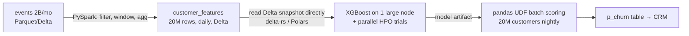

# M4 · ML at scale

> **Module question:** When do I use MLlib, pandas UDFs, or no Spark at all?
> **Cross-cutting threads:** Failure modes · Tradeoff ledger
> **Domain spine:** ShopCo churn model (20M customers × ~50 features)

---

## Opening scene: the `toPandas()` that killed the driver

The feature table is done: 20M rows × 50 columns. You call `train.toPandas()` so you can use XGBoost as you always do. The driver dies with an OOM after 6 minutes.

The data isn't too big for *a* machine (about 8 GB, see below). It's too big for *this route*: `toPandas()` funnels everything through the driver, which is usually sized small and briefly holds several copies of the data (JVM rows, Arrow batches, the pandas frame). The fix is not "a bigger driver". The question is *which part* of the work actually needs to be distributed.

- Driver memory is set by `spark.driver.memory`, and is often only a few GB by default
- `spark.driver.maxResultSize` (default `1g`) caps what `collect`/`toPandas` can pull back
  - With that default, an 8 GB `toPandas()` usually fails fast with a "bigger than spark.driver.maxResultSize" error
  - The slow OOM in this scene happens when someone has raised that cap (or set it to `0`, meaning unlimited)
- The Arrow copy exists only if `spark.sql.execution.arrow.pyspark.enabled=true`
  - Off by default in open-source Spark, on by default on Databricks
  - Without Arrow, `toPandas()` is also much slower (row-by-row conversion)
- "50 features" is the production table; the M2 code builds only a handful of them

> **Failure mode (the module in one line):** assuming everything must be distributed, or nothing must. The real answer is to distribute the data prep and size the training to the problem.

---

## 1. The decision table (the senior-DS answer)

| Situation | Approach |
|---|---|
| Training data fits in one machine's memory after aggregation (often true: 20M rows × 50 columns × 8-byte doubles ≈ 8 GB) | Spark for features → **write Parquet** → a separate large training node reads the Parquet directly (not `toPandas()` through the driver) and trains XGBoost/LightGBM. Sample if needed. |
| Many **independent** models (per store, per region, per segment) | `groupBy(...).applyInPandas(train_fn)`: each group trained in parallel with plain sklearn |
| One model on data that truly doesn't fit | **MLlib** pipeline, or distributed XGBoost/LightGBM on Spark |
| Batch **scoring** of a single-node model on a large table (ShopCo: 20M customers nightly) | pandas UDF that loads the model once per batch iterator |
| Hyperparameter search for a single-node model | Parallelize trials across the cluster (Optuna/Ray Tune-style, or a DataFrame of param sets + `applyInPandas`) |

**Interview line:** "Spark is my data-prep and orchestration layer. I only distribute the training itself when the data forces me to."

**"After aggregation"** means after M2's `groupBy("user_id")` turned 2B event rows into one row per customer (20M rows).

**Getting data from Spark to the training node (the first row):**
- Spark side: `train.write.mode("overwrite").parquet("s3://shopco/train/cutoff=2026-10-01/")`
  - Spark writes a *directory* of `part-*.parquet` files, one per task; that's normal
- Training node: `pdf = pd.read_parquet("s3://shopco/train/cutoff=2026-10-01/")`
  - pyarrow reads the whole directory as one table
  - If the table is **Delta** (see Other tools), use `deltalake.DeltaTable(path).to_pandas()` or `pl.read_delta(path)`
  - A plain Parquet reader on a Delta directory ignores the transaction log, so it can read stale, logically deleted files and return duplicates
- Size the node at 2–4× the data size
  - pandas frame + XGBoost's own `DMatrix` copy + working memory
  - 8 GB of features → a node with roughly 32–64 GB RAM
- Sampling when it doesn't fit:
  - Churners are rare, so sample per class: `train.sampleBy("churned", fractions={0: 0.2, 1: 1.0}, seed=42)`
  - That keeps every churner; reweight (or recalibrate probabilities) afterwards

**Parallel hyperparameter search (the HPO row):**
- Each trial is an ordinary single-node fit; Spark only runs many trials at once
- DataFrame route:
  - `params = spark.createDataFrame(param_rows).repartition(n_trials)` (one row per trial)
  - `params.groupBy("trial_id").applyInPandas(run_trial, schema=...)`
  - `run_trial` reads the training Parquet itself (or uses a broadcast sample); the data is not passed in through the rows
- Library routes: Optuna + `joblib-spark`, or Ray Tune
  - Hyperopt `SparkTrials` appears in older guides, but Hyperopt is largely unmaintained; check your platform before relying on it

**Distributed training when the data truly doesn't fit (the third row):**
- MLlib (see MLlib pipelines below)
- Distributed XGBoost: `from xgboost.spark import SparkXGBClassifier` (xgboost ≥ 1.7), used like an MLlib estimator
- Distributed LightGBM: SynapseML's `LightGBMClassifier`

## 2. MLlib pipelines (`pyspark.ml`)

The vocabulary mirrors sklearn:
- **Transformer:** `.transform(df) → df` (e.g. a fitted model, `VectorAssembler`)
- **Estimator:** `.fit(df) → Transformer` (e.g. `LogisticRegression`, `StringIndexer`)
- **Pipeline:** a chain of stages, and itself an Estimator
- **Difference from sklearn:** sklearn's `fit` mutates and returns the same object; MLlib's `fit` returns a **new** `...Model` object (e.g. `PipelineModel`), and that object is the Transformer

**How distributed training works (why it's the last resort):**
- Data-parallel: each executor computes partial statistics on its own partitions
  - Gradients for logistic regression, split histograms for trees
- The driver combines those partials, updates the model, and starts the next pass
- Iterative algorithms make many passes over the data
  - Cache the training DataFrame before `fit` (M3, Caching), or every pass re-reads and recomputes it
  - Every pass also pays task scheduling and network costs, so a single-node fit on data that fits is faster
- Ecosystem cost: fewer algorithms and tuning knobs; early stopping, custom losses and SHAP are weaker or missing

**Setup to run this locally** (M2 builds the real `train`; this is a synthetic stand-in):

```python
from pyspark.sql import SparkSession, functions as F

spark = SparkSession.builder.master("local[*]").appName("m4").getOrCreate()

countries = F.array(*[F.lit(c) for c in ["US", "DE", "FR", "IN", "BR"]])
train = (
    spark.range(100_000).withColumnRenamed("id", "user_id")
    .withColumn("n_orders", (F.rand(1) * 20).cast("int"))
    .withColumn("total_spend", F.rand(2) * 2000)
    .withColumn("days_since_last", (F.rand(3) * 90).cast("int"))
    .withColumn("country", F.element_at(countries, (F.rand(4) * 5).cast("int") + 1))  # 1-based
    .withColumn("region", F.when(F.col("country").isin("US", "BR"), "AMER")
                           .when(F.col("country") == "IN", "APAC").otherwise("EMEA"))
    .withColumn("churned", (F.rand(5) < F.col("days_since_last") / 150).cast("int"))
)
```

```python
# `train` = M2's training set joined with the customers table, which adds `country` and `region`
from pyspark.ml import Pipeline
from pyspark.ml.feature import StringIndexer, OneHotEncoder, VectorAssembler
from pyspark.ml.classification import GBTClassifier
from pyspark.ml.evaluation import BinaryClassificationEvaluator

idx = StringIndexer(inputCol="country", outputCol="country_idx", handleInvalid="keep")
ohe = OneHotEncoder(inputCols=["country_idx"], outputCols=["country_ohe"])
vec = VectorAssembler(
    inputCols=["n_orders", "total_spend", "days_since_last", "country_ohe"],
    outputCol="features",
)
gbt = GBTClassifier(featuresCol="features", labelCol="churned", maxIter=50)

train_df, test_df = train.randomSplit([0.8, 0.2], seed=42)
train_df.cache()                                    # GBT makes many passes over this
model = Pipeline(stages=[idx, ohe, vec, gbt]).fit(train_df)

auc = BinaryClassificationEvaluator(labelCol="churned").evaluate(model.transform(test_df))
```

MLlib quirks worth naming: features must be packed into a single **vector column**. Algorithm coverage is narrower than sklearn's. `CrossValidator` exists but fits every fold × param combination as separate distributed jobs, which is expensive.

**Reading the code:**
- **Vector column:** one column whose value in each row is a `DenseVector` or `SparseVector` holding all features
  - `VectorAssembler` builds it; MLlib estimators read only `featuresCol`
  - `OneHotEncoder` emits sparse vectors and drops the last category by default (`dropLast=True`)
- `handleInvalid="keep"` on `StringIndexer`: countries unseen at fit time get one extra index instead of failing at scoring time
- `VectorAssembler` fails on NULLs by default
  - Use `handleInvalid="skip"` (drop the row) or `"keep"` (emit NaN), or fill first with `pyspark.ml.feature.Imputer`
- One-hot encoding is optional for trees
  - `GBTClassifier` can use `country_idx` directly if `maxBins` ≥ the number of categories (default 32; ShopCo has 60 countries)
- `model.transform(df)` adds three columns:
  - `rawPrediction` (margins), `probability` (a vector: [p(0), p(1)]), `prediction` (0/1)
  - To get p(churn) as a number: `from pyspark.ml.functions import vector_to_array`, then `vector_to_array("probability")[1]`
- `BinaryClassificationEvaluator` defaults to `areaUnderROC`
  - For rare churn, also report `metricName="areaUnderPR"`
- `CrossValidator(..., parallelism=4)` fits several models at once; `TrainValidationSplit` (one split instead of k folds) is the cheaper option

**Evaluation choices:**
- `randomSplit` is fine for a demo; for churn, prefer an **out-of-time** split
  - Train on cutoff T, validate on cutoff T + 1 month (the same point-in-time idea as M2's worked example)
- `randomSplit` can return different rows if `train` is recomputed with different partitioning; cache or write it first
- Class imbalance: `GBTClassifier` accepts a `weightCol` (Spark 3.0+)

**Saving and scoring an MLlib model:**
- Save: `model.write().overwrite().save("s3://shopco/models/churn_gbt/")`
- Load: `from pyspark.ml import PipelineModel`, then `PipelineModel.load(path)`
- Score: `PipelineModel.load(path).transform(df)` is already distributed, so no pandas UDF is needed
  - The pandas UDF route in the next section is only for **single-node** models (sklearn, XGBoost)

## 3. pandas UDFs and `applyInPandas`: sklearn inside Spark

**Many models, one per group:**

```python
import pickle
import pandas as pd
from sklearn.linear_model import LogisticRegression
from sklearn.metrics import roc_auc_score
from sklearn.model_selection import train_test_split

FEATS = ["n_orders", "total_spend", "days_since_last"]

def train_region(pdf: pd.DataFrame) -> pd.DataFrame:
    region = pdf["region"].iloc[0]
    if pdf["churned"].nunique() < 2:                 # one class → sklearn would raise and kill the job
        return pd.DataFrame({"region": [region], "model": [None], "test_auc": [None]})
    X_tr, X_te, y_tr, y_te = train_test_split(
        pdf[FEATS], pdf["churned"], test_size=0.2, random_state=42, stratify=pdf["churned"])
    m = LogisticRegression(max_iter=200).fit(X_tr, y_tr)
    auc = roc_auc_score(y_te, m.predict_proba(X_te)[:, 1])
    return pd.DataFrame({"region": [region], "model": [pickle.dumps(m)], "test_auc": [auc]})

results = train.groupBy("region").applyInPandas(
    train_region, schema="region string, model binary, test_auc double"
)
results.write.mode("overwrite").parquet("s3://shopco/models/churn_by_region/")  # the action: training runs now
```

Each group must fit in one executor's memory, so a skewed group (M3) brings the same problem back.

- `applyInPandas` shuffles rows by the `groupBy` key, then hands each **whole group** to your function as one pandas DataFrame
- `results` is lazy (M1, Lazy evaluation); nothing trains until an action such as `write` or `show`
- The `schema` is a DDL string; its names and types must match the returned DataFrame exactly
- Keep the models, not just the metrics:
  - Return `pickle.dumps(m)` in a `binary` column (as above), or
  - Write each model from inside the function to `f".../region={region}.pkl"`, or log it to MLflow
- Report a held-out metric; training-set accuracy says nothing about generalization
- Set `n_jobs=1` (or `OMP_NUM_THREADS=1`) for sklearn/XGBoost inside the function
  - Spark already runs one task per core; extra threads per task oversubscribe the CPU
- sklearn must be installed on **every executor**, not just your notebook (see Shipping the model below)

**Distributed scoring of a single-node model:**

```python
from typing import Iterator

MODEL_PATH = "/dbfs/models/churn.pkl"   # Databricks path; must be readable on every executor (see below)

@F.pandas_udf("double")
def predict(batches: Iterator[pd.DataFrame]) -> Iterator[pd.Series]:
    import joblib
    model = joblib.load(MODEL_PATH)   # loaded once per task (one partition), not per batch or row
    for pdf in batches:
        yield pd.Series(model.predict_proba(pdf)[:, 1])

# `features` = M2's feature table, recomputed with today's cutoff (the customers to score)
scored = features.withColumn(
    "p_churn", predict(F.struct("n_orders", "total_spend", "days_since_last"))
)
```

**How this UDF runs:**
- Spark picks the pandas UDF type from the **type hints**
  - `Iterator[...] -> Iterator[...]`: one call per partition, which receives a stream of batches
  - Plain `pd.Series -> pd.Series` (M2's UDF): one call per batch, so `joblib.load` would run thousands of times
- A **batch** is up to `spark.sql.execution.arrow.maxRecordsPerBatch` rows (default 10,000), sent via Arrow
- `F.struct("a", "b", "c")` arrives in Python as a `pd.DataFrame` with columns `a`, `b`, `c`
  - Names and order must match what the model was trained on
- Each yielded Series must have the same length as its input batch
- `scored` is lazy; write it to a table to actually score

**Shipping the model and libraries to executors:**
- `MODEL_PATH` must be readable from **every** executor, not just the driver
  - Shared storage: `/dbfs/...` on Databricks, or download from S3 inside the UDF
  - `spark.sparkContext.addFile("s3://.../churn.pkl")`, then `SparkFiles.get("churn.pkl")` inside the UDF
  - Or broadcast the loaded model: `bc = spark.sparkContext.broadcast(model)`, then use `bc.value` inside the UDF
  - In local mode a local path works, because driver and executors share one machine
- Every executor needs the same sklearn/xgboost version (cluster libraries or a packed conda/venv env)
  - A version mismatch typically breaks unpickling
- Production norm: `mlflow.pyfunc.spark_udf(spark, model_uri)` handles loading and dependencies for you

## 4. Other tools to name-drop correctly

- **pandas API on Spark** (`import pyspark.pandas as ps`, Spark 3.2+): pandas syntax on Spark execution. Good for porting; hidden shuffles (e.g. index alignment) can surprise you.
- **Spark Connect** (3.4+): a thin client talking to a remote Spark server, which separates your notebook process from the cluster driver.
- **Delta Lake / Iceberg:** ACID tables on Parquet, time travel (reproducible training sets: "train on the table as of version N"), and MERGE for upserts.
  - ACID: a write either fully lands or doesn't, so readers never see a half-written table
  - Each write creates a new table **version**, recorded in a transaction log next to the Parquet files
  - Time travel read: `spark.read.format("delta").option("versionAsOf", 12).load(path)` (or `timestampAsOf`)
  - Upsert = update the row if its key exists, insert it otherwise; written as `MERGE INTO`
  - `VACUUM` deletes files of old versions, so the retention setting limits how far back you can travel
  - Reproducibility recipe: log table version + random seed + git SHA + library versions with the model (e.g. in MLflow)
- **When not to use Spark:** under roughly tens of GB, **DuckDB or Polars** on one machine is often faster and simpler. Saying this in a senior interview is a plus.

> **Tradeoff (the ledger entry):** training single-node after distributed feature prep costs a hard ceiling on training-set size, so you may need to sample. Accepted because it keeps the full XGBoost/sklearn ecosystem, is faster to iterate on, and is enough for most tabular problems after aggregation.

---

## Worked example: ShopCo's actual architecture



- **events → customer_features:** the only step that touches 2B rows, so it's the one that needs Spark (M2, M3)
- **customer_features → XGBoost node:** ~8 GB after aggregation, so one 32–64 GB node trains it (see The decision table)
  - Read through a Delta reader, not a raw Parquet reader, to avoid stale files
  - HPO trials run on the Spark cluster as parallel single-node fits; the final model is refit on the large node
- **model → scoring:** the pickled model goes to shared storage; the pandas UDF loads it once per partition on each executor
- **scoring → CRM:** results are written as a table that the CRM reads; Spark never serves requests (M1)

---

## Design exercise
> *Paper-based. Think, then write.*

**Task.** ShopCo now wants a separate churn model **per country** (60 countries; the US has 40% of customers).
1. Choose MLlib, `applyInPandas`, or a loop over single-node fits. Justify the choice.
2. The US group will be skewed. How do you handle it?
3. How do you make training reproducible six months from now? (Hint: table versioning + seed + code version.)

**Answer sketch (read after trying):**
- Q1, the three options:
  - Loop: a driver-side `for c in countries:` that filters, fits and saves; runs one country at a time, so it suits only a few small groups
  - `applyInPandas`: all countries train in parallel, each with plain sklearn; the natural fit for 60 independent models
  - MLlib: one distributed fit per country would be 60 sequential distributed jobs, which is overkill for small groups
- Q2, the skewed US group:
  - M3's salting doesn't apply: you can't split one model fit across salted sub-keys
  - Route the 59 small countries through `applyInPandas`; train the US on the large training node (or a stratified US sample)
  - If the US still doesn't fit: distributed XGBoost for that one model
  - Splitting the US into sub-models (e.g. by state) is a product decision, not a performance trick
- Q3, reproducibility: Delta `versionAsOf` + fixed seeds + git SHA + pinned library versions, logged with the model (see Other tools)

**Why this exercise matters.** It combines all four modules: plan shape, feature grain, skew, and ML tooling. That combination is the conversation a senior interviewer wants to have.

---

**Verification note:** Light mode. Steps 7–8 skipped at the user's request; API claims are from author knowledge of Spark 3.x.

**Next module:** [M5 — Interview talk-track](../05-interview-talk-track/README.md): turning this into what you say.
